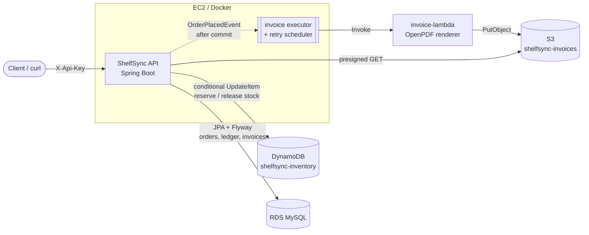

# ShelfSync

A personal inventory and billing service built with Java 17 and Spring Boot on AWS.

ShelfSync tracks stock in real time and bills sales automatically:

- **Live inventory in DynamoDB.** Each SKU's current stock, price and reorder level. Stock only changes through conditional atomic updates (`stock >= :qty`), so two checkouts running at the same time can never oversell.
- **Transaction history in RDS MySQL.** Every stock movement (opening balance, restock, adjustment, sale, reversal), every order and every invoice goes into a ledger you can query with SQL. Flyway manages the schema.
- **Invoice generation on AWS Lambda.** After checkout commits, the API invokes a Lambda in the background. The Lambda renders a PDF (OpenPDF) and stores it in **S3**. Downloads use short-lived presigned URLs.
- **Automated retries.** A scheduled job picks up invoices that failed or were never generated (for example, if the app restarted mid-flight).

## Architecture



### Checkout flow

A checkout spans two stores that cannot share a transaction, so it runs as a small saga:

```
POST /api/v1/orders
  1. for each line: DynamoDB UpdateItem  stock = stock - qty  IF stock >= qty   (reserve)
       └─ on failure → release earlier reservations, return 409
  2. MySQL transaction: order + lines + SALE ledger rows + PENDING invoice
       └─ on failure → release all reservations, rethrow
  3. after commit → OrderPlacedEvent → (async) Lambda renders PDF → S3 → invoice GENERATED
```

Restocks and manual adjustments work the same way: the DynamoDB change happens first, then the ledger row is written. If the ledger write fails, the stock change is reverted. Checkouts accept an `Idempotency-Key` header, so a client can safely retry a request.

### Modules

| Module | Purpose |
|---|---|
| `invoice-core` | Invoice payload model, S3 key layout, and the PDF renderer, shared by the API and the Lambda |
| `invoice-lambda` | `RequestHandler<InvoiceRequest, InvoiceResult>`, built as a shaded jar |
| `shelfsync-api` | Spring Boot REST service (inventory, billing, ledger, invoices) |

## API

All endpoints except `/actuator/health` need the `X-Api-Key` header when `SHELFSYNC_API_KEY` is set.

| Method | Path | Description |
|---|---|---|
| `POST` | `/api/v1/items` | Create an item (`sku`, `name`, `category`, `unitPrice`, `initialStock`, `reorderLevel`) |
| `GET` | `/api/v1/items?category=` | List items, optionally filtered by category (GSI) |
| `GET` | `/api/v1/items/low-stock` | Items at or below their reorder level |
| `GET` / `PATCH` / `DELETE` | `/api/v1/items/{sku}` | Read, edit metadata (optional `expectedVersion`), or delete an item |
| `POST` | `/api/v1/items/{sku}/restock` | `{ "quantity": 10, "note": "..." }` |
| `POST` | `/api/v1/items/{sku}/adjust` | `{ "quantity": -2, "note": "breakage" }` |
| `POST` | `/api/v1/orders` | Checkout. Body `{ customerName, customerEmail, lines: [{sku, quantity}] }`, optional `Idempotency-Key` header |
| `GET` | `/api/v1/orders`, `/api/v1/orders/{orderNumber}` | List orders (paged) or get one |
| `POST` | `/api/v1/orders/{orderNumber}/cancel` | Cancel an order, void its invoice and return its stock |
| `GET` | `/api/v1/invoices/{invoiceNumber}` | Invoice status, including a presigned URL once generated |
| `GET` | `/api/v1/invoices/{invoiceNumber}/pdf` | 302 redirect to the PDF |
| `POST` | `/api/v1/invoices/{invoiceNumber}/regenerate` | Render the PDF again |
| `GET` | `/api/v1/ledger/items/{sku}` | Stock movement history for one SKU |
| `GET` | `/api/v1/ledger/movements?from=&to=` | All movements in a time range |
| `GET` | `/api/v1/ledger/sales?from=&to=` | Net units sold per SKU |

## How to run

### Prerequisites

- JDK 17+ and Maven 3.9+
- Docker, to run MySQL and LocalStack locally
- AWS CLI, for the deploy scripts. `awslocal` is optional.

### Local (MySQL + LocalStack)

```bash
cp .env.example .env              # adjust if needed
docker compose up -d mysql localstack
# LocalStack's init hook creates the DynamoDB table and S3 bucket.

mvn -B -DskipTests install
SPRING_PROFILES_ACTIVE=local mvn -pl shelfsync-api spring-boot:run
```

The `local` profile points the AWS SDK at `http://localhost:4566` and sets `INVOICE_GENERATOR=local`. In this mode, invoices are rendered inside the API process using the same `invoice-core` renderer and uploaded to LocalStack S3, so you don't need to deploy the Lambda.

To test the real Lambda path against LocalStack:

```bash
./infra/deploy-lambda.sh --local
INVOICE_GENERATOR=lambda SPRING_PROFILES_ACTIVE=local mvn -pl shelfsync-api spring-boot:run
```

To run the whole stack in containers instead:

```bash
docker compose --profile app up --build
```

### Try it

```bash
curl -X POST localhost:8080/api/v1/items -H 'Content-Type: application/json' \
  -d '{"sku":"MUG-01","name":"Ceramic mug","category":"kitchen","unitPrice":7.50,"initialStock":20,"reorderLevel":5}'

curl -X POST localhost:8080/api/v1/orders -H 'Content-Type: application/json' -H 'Idempotency-Key: order-001' \
  -d '{"customerName":"Ada Lovelace","customerEmail":"ada@example.com","lines":[{"sku":"MUG-01","quantity":2}]}'

curl localhost:8080/api/v1/invoices/INV-YYYYMMDD-000001     # number comes from the order response
curl localhost:8080/api/v1/ledger/items/MUG-01
```

### On AWS

1. Run `INVOICE_BUCKET=<unique-name> ./infra/create-aws-resources.sh` to create the DynamoDB table (with the `category-index` GSI and PITR) and a private S3 bucket.
2. Create an RDS MySQL 8 instance and a database named `shelfsync`. Flyway creates the tables on first start.
3. Run `LAMBDA_ROLE_ARN=arn:aws:iam::<acct>:role/<role> ./infra/deploy-lambda.sh`. The role needs `s3:PutObject` on the bucket.
4. Run the API container on EC2 (`docker build -f shelfsync-api/Dockerfile .`). The instance role needs:
   - `dynamodb:GetItem`, `PutItem`, `UpdateItem`, `DeleteItem`, `Scan` and `Query` on the table and its index
   - `lambda:InvokeFunction`
   - `s3:GetObject` on the bucket, for presigned URLs
5. Set the environment variables listed in `.env.example`. Leave `AWS_ENDPOINT_OVERRIDE` empty and set `INVOICE_GENERATOR=lambda` and `SHELFSYNC_API_KEY`.

## How to test

```bash
mvn test                       # all modules
mvn -pl invoice-core test      # PDF renderer + key layout
mvn -pl invoice-lambda -am test
mvn -pl shelfsync-api -am test
```

The test suite needs no Docker or AWS access. It covers:

- **invoice-core**: the renderer produces a valid PDF, rejects bad input, formats money correctly, and builds S3 keys with the expected layout.
- **invoice-lambda**: the handler uploads to the configured bucket and key, with a mocked `S3Client`.
- **shelfsync-api**:
  - checkout totals and tax rounding, duplicate-line merging, stock release when stock is short or the database fails, and idempotent replay
  - inventory ledgering, and reverting stock when the ledger write fails
  - controller validation, API-key auth, and 409 mapping (via `@WebMvcTest`)

## Configuration

All settings are environment variables. See `.env.example` and `shelfsync-api/src/main/resources/application.yml`. The main ones:

| Variable | Default | Meaning |
|---|---|---|
| `MYSQL_URL` / `MYSQL_USER` / `MYSQL_PASSWORD` | localhost | RDS MySQL connection |
| `AWS_REGION` | `us-east-1` | AWS region |
| `AWS_ENDPOINT_OVERRIDE` | empty | Set to LocalStack's URL for local runs |
| `INVENTORY_TABLE` | `shelfsync-inventory` | DynamoDB table |
| `INVOICE_BUCKET` | `shelfsync-invoices` | S3 bucket for PDFs |
| `INVOICE_GENERATOR` | `lambda` | `lambda` or `local` |
| `INVOICE_LAMBDA_FUNCTION` | `shelfsync-invoice-generator` | Function name |
| `BILLING_TAX_RATE` / `BILLING_CURRENCY` | `0.08` / `USD` | Billing settings |
| `SHELFSYNC_API_KEY` | empty (auth off) | Shared secret for the `X-Api-Key` header |
